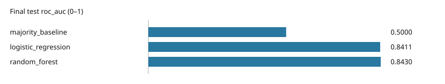
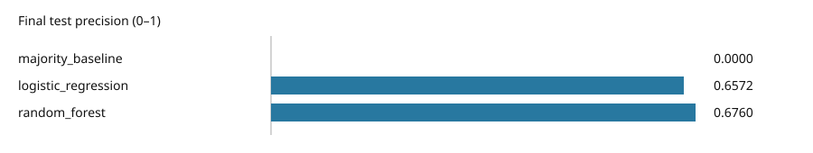
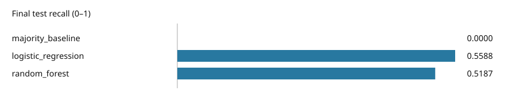
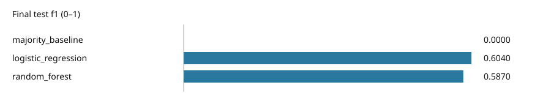
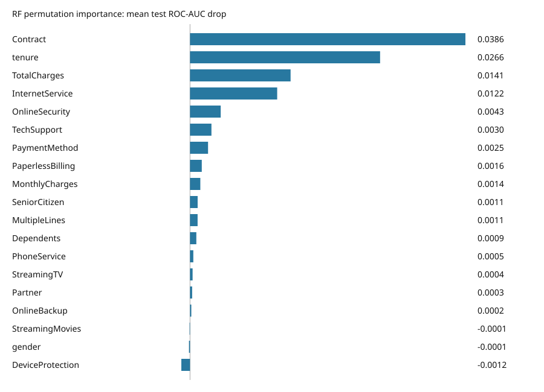

# Final evaluation and retention hypotheses

Source: [IBM Telco Customer Churn](https://github.com/IBM/telco-customer-churn-on-icp4d).
Execution order: `overview.py` → `prepare.py` → `train.py` → `evaluate.py`.
Run each from the repository root with `nix develop --command uv run python <script>`.
Tests: `nix develop --command uv run python -m unittest test_train.py test_evaluate.py`.

Settings and threshold were frozen before evaluation. All models used the same
5,634 training and 1,409 test customers. Churn = Yes is positive.
No retuning or threshold selection used test performance. Completed evaluations
are not overwritten; reproduction should use a separate output directory via
`evaluate(source, preparation)` after recreating preparation/tuning there.

## Test performance

| Model | ROC-AUC | Precision | Recall | F1 |
|---|---:|---:|---:|---:|
| majority_baseline | 0.5000 | 0.0000 | 0.0000 | 0.0000 |
| logistic_regression | 0.8411 | 0.6572 | 0.5588 | 0.6040 |
| random_forest | 0.8430 | 0.6760 | 0.5187 | 0.5870 |

Threshold: probability > 0.5; exact ties predict No. Undefined precision is zero.
ROC-AUC uses probabilities, not predicted classes. Single-split scores are not
proof of a statistically significant difference or future deployment performance.

## Confusion matrices

### majority_baseline

| Actual / predicted | No | Yes |
|---|---:|---:|
| No | 1035 | 0 |
| Yes | 374 | 0 |

### logistic_regression

| Actual / predicted | No | Yes |
|---|---:|---:|
| No | 926 | 109 |
| Yes | 165 | 209 |

### random_forest

| Actual / predicted | No | Yes |
|---|---:|---:|
| No | 942 | 93 |
| Yes | 180 | 194 |

## Which predictors contribute?

Random Forest permutation importance measures the change in final test ROC-AUC
when one original predictor is shuffled (10 repeats). Top five:

- `Contract`: mean ROC-AUC drop 0.0386, repeat SD 0.0046.
- `tenure`: mean ROC-AUC drop 0.0266, repeat SD 0.0022.
- `TotalCharges`: mean ROC-AUC drop 0.0141, repeat SD 0.0017.
- `InternetService`: mean ROC-AUC drop 0.0122, repeat SD 0.0046.
- `OnlineSecurity`: mean ROC-AUC drop 0.0043, repeat SD 0.0019.

Repeat SD describes shuffle variability, not a confidence interval.
Correlated or redundant predictors can share or mask importance. Negative values
do not establish a protective association. These are post-hoc interpretations,
not a new feature-selection step.

### Logistic Regression conditional associations

| Predictor | Comparison | Odds ratio |
|---|---|---:|
| tenure | Increase of one training standard deviation | 0.277 |
| MonthlyCharges | Increase of one training standard deviation | 0.132 |
| TotalCharges | Increase of one training standard deviation | 1.751 |
| gender | Male versus Female | 1.024 |
| SeniorCitizen | 1 versus 0 | 1.159 |
| Partner | Yes versus No | 1.019 |
| Dependents | Yes versus No | 0.801 |
| PhoneService | Yes versus No | 1.747 |
| MultipleLines | No phone service versus No | 0.811 |
| MultipleLines | Yes versus No | 1.859 |
| InternetService | Fiber optic versus DSL | 11.832 |
| InternetService | No versus DSL | 1.740 |
| OnlineSecurity | No internet service versus No | 0.483 |
| OnlineSecurity | Yes versus No | 0.913 |
| OnlineBackup | No internet service versus No | 0.546 |
| OnlineBackup | Yes versus No | 1.166 |
| DeviceProtection | No internet service versus No | 0.585 |
| DeviceProtection | Yes versus No | 1.340 |
| TechSupport | No internet service versus No | 0.495 |
| TechSupport | Yes versus No | 0.960 |
| StreamingTV | No internet service versus No | 0.788 |
| StreamingTV | Yes versus No | 2.429 |
| StreamingMovies | No internet service versus No | 0.789 |
| StreamingMovies | Yes versus No | 2.437 |
| Contract | One year versus Month-to-month | 0.498 |
| Contract | Two year versus Month-to-month | 0.253 |
| PaperlessBilling | Yes versus No | 1.448 |
| PaymentMethod | Credit card (automatic) versus Bank transfer (automatic) | 0.974 |
| PaymentMethod | Electronic check versus Bank transfer (automatic) | 1.471 |
| PaymentMethod | Mailed check versus Bank transfer (automatic) | 1.082 |

All categorical levels were one-hot encoded. Accordingly, category comparisons
use coefficient differences against the first training category, not the
individual dummy coefficient. Numerical odds ratios correspond to one training
standard deviation after imputation/scaling, not a one-unit raw change.
These are regularized, model-dependent conditional associations. Related and
structurally dependent service categories limit "holding everything else fixed"
interpretations. No causal effects or statistical significance are established.

## Retention hypotheses to test

- Earlier descriptive results suggest prioritizing an onboarding-support pilot
  for newer customers, rather than assuming longer tenure itself prevents churn.
- Investigate month-to-month customers' flexibility and value needs; test voluntary
  offers rather than assuming longer contracts cause retention.
- Test service/support outreach where useful, not blanket add-on sales.
- Use predicted risk to prioritize a controlled retention experiment, not to
  assume a high-risk customer will benefit from an intervention. Choose operating
  thresholds later using training validation, contact capacity and intervention
  costs—not by optimizing on this test set.
- Do not target or disadvantage customers solely on demographics.

## Limitations

- Earlier descriptive exploration included the full dataset, including eventual
  test customers: this is not a fully untouched confirmatory holdout.
- One observational dataset and a random split cannot establish causal effects,
  future-time performance or generalization to another company.
- Services record subscriptions, not usage intensity. Measurement timing relative
  to churn and the prediction horizon need verification.
- All 19 candidates were retained; correlated predictors complicate interpretation.
- No confidence intervals, fairness audit or intervention-benefit validation
  is provided. Recommendations are hypotheses, not proven retention actions.

Settings, source/code hashes, predictions, metrics, contrasts and importance
repeats are saved here for review and later KNIME comparison.
